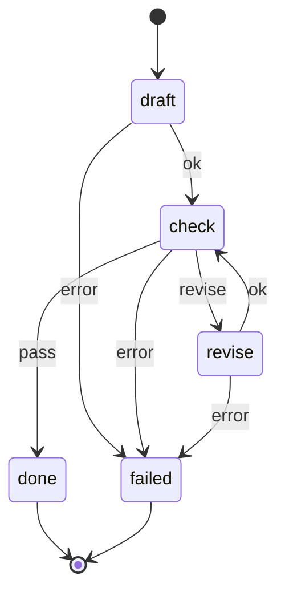

# Wearable

A foundation for declarative AI agents: describe a machine in YAML, validate and compile it into a runtime-independent plan, then execute that plan through explicitly registered capabilities.

**Status: algorithmic design sketch.** This repository contains pseudocode and example declarations, not an implemented compiler or runnable agent. The YAML vocabulary is a proposed v0.1 contract. No model provider, execution backend, or programming language is selected yet.

## 1. The smallest useful machine

Start with a deterministic finite-state controller. An LLM or tool performs work at a state and returns one symbol from a declared finite alphabet. The transition table, rather than free-form model text, determines the next state.

Let the controller be:

```text
M = (Q, Σ, δ, q₀, F_accept, F_reject, A)
Q              finite set of named states
Σ              finite set of observable event symbols
δ: Q × Σ ⇀ Q   partial deterministic transition function
q₀ ∈ Q         initial state
F_accept       successful terminal states
F_reject       unsuccessful terminal states (disjoint from F_accept)
A              action binding for every nonterminal state
```

At runtime the configuration is `(state, context, steps, trace)`. Context holds input and action results; it is data, not executable code. Each nonterminal state invokes exactly one action on entry. Its result chooses exactly one outgoing transition. Terminal states invoke nothing.

For a completed event sequence `w ∈ Σ*`, the controller accepts when the extended transition function reaches an accepting state. Its allowed control traces form a regular language. Which traces actually occur depends on the environment and action results.

**Expressiveness boundary:** finite control does not make an entire LLM/tool system a finite automaton. Arbitrary context and external programs can introduce unbounded computation. With finite context domains and finite action-result abstractions, the complete internal state can be modeled finitely. The proposed foundation claims deterministic routing for a given event sequence, not deterministic LLM output or general Turing completeness.

## 2. Declarations and boundaries

Three YAML documents describe one program:

| Document | Responsibility |
| --- | --- |
| [agent.yaml](examples/agent.yaml) | States, alphabet, transitions, input names and action bindings |
| [tools.yaml](examples/tools.yaml) | Named capabilities and their input/output contracts |
| [runtime.yaml](examples/runtime.yaml) | Backend selection, adapter bindings and execution limits |

"Tools" includes model calls and ordinary functions. Declarations refer to adapter IDs; a host application must supply implementations in a registry. YAML never imports code or installs a runtime. Future backends may interpret the same compiled plan or generate executable code.

The v0.1 vocabulary deliberately supports only:

- A single machine with sequential execution and one action per nonterminal state.
- Required named inputs and outputs, each of type `string` for this first sketch.
- Input references of the form `{input: name}`, or `{result: state_name, field: name}`.
- A finite list of events per capability; a result envelope `{event, output}`.
- One transition for each possible event at each nonterminal state.
- Accept/reject terminal states and a positive transition budget.

Result references mean the latest successfully completed invocation of that state. The compiler must prove the referenced result exists on every incoming path. References cannot inspect arbitrary expressions, invoke functions, or read environment variables.

## 3. Example: draft, check, revise

The supplied example drafts a response, checks it, and loops through revision until the check returns `pass`. The author input contains the request; check feedback supplies revision instructions.



An example accepted trace:

```text
draft --ok--> check --revise--> revise --ok--> check --pass--> done
```

Here `draft` and `revise` both write a named result field into `context.values.answer` using `save`. The checker reads it through `{value: answer}`. A value reference is an additional explicit reference form, subject to the same definite-assignment rule. This avoids requiring the checker to know which state last produced the answer. Saved values are string slots, declared in `values`, and are updated only after a successful, contract-valid action result.

The example's model adapters are placeholders. A host would have to implement `llm.draft`, `llm.check`, and `llm.revise`, including any prompts, credentials and provider-specific calls. A model's `pass` event is a routing decision, not proof that its answer is correct.

## 4. Compilation algorithm

Compilation produces a validated intermediate representation (IR); execution is a separate operation. In this sketch, "compile" means linking declarations into an executable plan for an interpreter, not generating a native binary.

```text
COMPILE(agent_yaml, tools_yaml, runtime_yaml, host_registry):
    docs := parse_safe_yaml(agent_yaml, tools_yaml, runtime_yaml)
        # reject duplicate keys, custom tags and unsupported versions/fields
        # apply parser size/depth limits; never evaluate embedded code
    validate_required_fields_and_types(docs)

    require all state, capability and value names are unique
    require initial state exists
    require terminal sets are disjoint and at least one accept state exists
    require max_steps and action_timeout_ms are positive integers
    require runtime backend is supported by host_registry

    for each capability:
        require input/output fields have supported types
        require event names are unique, nonempty and exclude reserved "error"
        require its configured adapter exists in host_registry
        require adapter supports the declared contract

    for each state:
        if terminal:
            require no action, inputs, save or outgoing transitions
        else:
            resolve capability and validate exact input names/reference forms
            require outgoing event keys = capability.events ∪ {"error"}
            require every event belongs to agent.alphabet
            require each target state exists
            require save sources are declared output fields
            require save destinations are declared value slots

    reachable := graph_search(initial, transitions)
    require all declared states are reachable
    require an accepting state is reachable
    require every reachable state has a graph path to a terminal
        # this is structural; it does not prove execution will terminate

    definite_assignment_analysis():
        # forward must-analysis: intersect facts at incoming edges
        # start with no action results or assigned values at entry
        # initialize other nodes to top, iterate to a fixed point
        # non-error edges add this state's result and saved values
        # error edges retain prior facts but add nothing
        # include the empty entry path when the initial state has back-edges
        require every result/value reference is assigned before its action

    return immutable Plan(
        version, initial, terminals,
        action_table, transition_table,
        reference_bindings, save_bindings,
        capability_contracts, adapter_ids, limits
    )
```

Compiler errors should identify a document path and reason, for example:
`agent.states.check.on.pass: unknown state "complete"`. Unknown fields must fail validation so misspellings cannot silently change behavior.

The definite-assignment check accepts the example: `answer` is written by `draft` before the first check and retained across revisions; `check.feedback` exists before entering `revise`. An error edge must not make a missing result appear initialized.

## 5. Execution algorithm

The host binds the compiled adapter IDs to implementations before execution. Credentials and live resource handles belong to the host, not the plan.

```text
RUN(plan, input, adapters):
    validate input against plan's declared inputs
    context := {input: immutable_copy(input), results: {}, values: {}}
    state := plan.initial
    steps := 0
    trace := []

    loop:
        if state is terminal:
            return RunResult(
                status = state.terminal, state, context, steps, trace
            )
        if steps == plan.max_steps:
            return RunResult(status = "budget_exhausted", state, steps, trace)

        args := resolve_references(plan.inputs[state], context)
        steps := steps + 1

        try:
            reply := invoke_with_timeout(
                adapters[plan.adapter_id[state]], args,
                plan.action_timeout_ms
            )
            validate reply.event in capability.events
            validate reply.output has exactly the declared string fields
            event := reply.event
            staged_result := immutable_copy(reply.output)
        catch adapter_exception, timeout, invalid_reply:
            event := "error"
            staged_result := NONE

        next := plan.transition_table[state, event]
        if staged_result is not NONE:
            context.results[state] := staged_result
            apply_save_bindings_atomically(state, staged_result, context.values)
        append trace with (steps, state, event, next)
        state := next
```

The reserved `error` event is generated by the executor; adapters return only their declared events. Failed invocations leave earlier results and values unchanged. Every invocation consumes a step, including errors. A transition reaching a terminal on the final allowed step succeeds because terminal handling precedes the next budget check.

A missing binding or transition after compilation is a host/plan integrity error: stop execution rather than asking the model to improvise. The minimal engine performs no automatic retries. The host must enforce timeout behavior; cancellation does not roll back remote side effects. Durable execution, retries and idempotency need separate semantics later.

A run returns `accept`, `reject`, or `budget_exhausted`, alongside its final state and trace (and context for terminal results). Budget exhaustion is an operational stop, not rejection by the formal machine. The step budget bounds invocations; it bounds elapsed time only when the host reliably enforces action timeouts.

## 6. Optional path toward a Turing machine

A future, separate machine profile could replace ordinary context operations with an explicit tape:

```text
T = (Q, Σ, Γ, δ, q₀, q_accept, q_reject, blank)
δ: (Q × Γ) ⇀ (Q × Γ × {LEFT, RIGHT, STAY})

STEP_TAPE(state, tape, head):
    read := tape[head] or blank
    (next, write, move) := δ[state, read]
    tape[head] := write
    head := head + offset(move)
    return (next, tape, head)
```

Here Γ is a finite tape alphabet containing the input alphabet Σ and a distinct blank symbol. A potentially unbounded tape, a movable head, and suitable transition programs provide the standard Turing-machine model. A bounded tape remains finite-state; a bounded run is only a finite simulation. Simply adding a list called "memory" or calling an LLM does not establish Turing completeness.

This extension would need a separate YAML grammar, validation rules and executor. It is intentionally not mixed into the initial agent profile. A pushdown profile with a stack could be considered between finite control and a tape if nested workflows become necessary.

## 7. Acceptance cases for a future implementation

These are behavioral specifications, not an existing automated test suite. Stub adapters are sufficient to test them without a model service.

| Case | Expected result |
| --- | --- |
| Draft emits `ok`; check emits `pass` | Accept in two steps |
| Draft `ok`, check `revise`, revise `ok`, check `pass` | Accept in four steps with revised answer |
| Adapter throws, times out, emits unknown event, or returns malformed output | Executor emits `error`; example reaches `failed` |
| Checker repeatedly requests revision | Stop at max_steps; no extra invocation |
| Checker passes on the last permitted step | Accept, not budget_exhausted |
| YAML has duplicate transition keys or an unknown field | Compile error |
| Transition points to an absent state or omits `error` | Compile error |
| Value/result may be unassigned along an incoming path | Compile error |
| Adapter ID cannot be resolved | Compile/link error |
| Unreachable state or a region with no path to a terminal | Compile error |

## 8. Implementation boundary

The next small implementation could contain just a safe YAML loader, compiler to the Plan structure, sequential interpreter, and in-memory stub adapter registry, with the cases above as tests.

Provider integrations, arbitrary runtime configurations, JSON Schema support, streaming, persistence, parallel states, multi-agent coordination, sandboxing, retries, formal model checking and a tape executor are future work. Supporting new configuration types should mean extending a versioned grammar and adapter contract, not promising that arbitrary YAML can execute.
