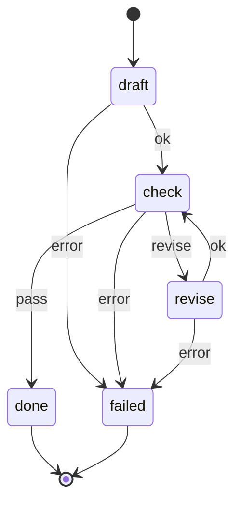

# Wearable

A foundation for declarative AI agents: describe a machine in YAML, validate and compile it into a runtime-independent plan, then execute that plan through explicitly registered capabilities.

**Status: minimal working Python prototype.** The v0.1 YAML contract is implemented by a strict loader, validator/compiler and sequential interpreter. The example runs with deterministic offline stub tools; optional Ollama and OpenAI Agents SDK adapters enable local inference or an SDK harness inside each state.

## Run the prototype

Requires Python 3.11 or newer. From the repository root:

```sh
python3 -m venv .venv
. .venv/bin/activate
python -m pip install -r requirements.txt
python -m wearable --request "Explain finite-state agents"
python -m unittest discover -s tests -v
```

The example prints a JSON result with `status: accept`, `steps: 4`, the revised answer in `context.values.answer`, and the `ok → revise → ok → pass` trace. It makes no network calls and needs no credentials. CLI exit codes are 0 for acceptance, 1 for rejection/budget exhaustion, and 2 for invalid declarations or input files.

Use `--agent`, `--tools` and `--runtime` to select other YAML files. The CLI supplies a single `request` input; use the Python API for other input shapes:

```python
import asyncio
from wearable import load_plan, run
from stub_tools import REGISTRY

plan = load_plan("examples/agent.yaml", "examples/tools.yaml",
                 "examples/runtime.yaml", REGISTRY)
result = asyncio.run(run(plan, {"request": "Explain agents"}, REGISTRY))
print(result["context"]["values"]["answer"])
```

`wearable.py` holds the loader, compiler, immutable plan, executor and CLI. `stub_tools.py` holds the three example adapters. An adapter is an `Adapter(inputs, outputs, events, call)` record; the first three arguments are tuples of field/event names and `call` is an async function accepting a dictionary and returning `{event, output}`. The registry is checked at compilation and again before execution. Plans contain declarations, not live functions.

### SDK wearable and evaluation MVP

- [OpenAI Agents SDK adapter](docs/openai-adapter.md): YAML-configured SDK agent with allowlisted tools and a separate inner turn limit.
- [Traceability and evaluation](docs/evaluation.md): optional SQLite metadata logs, SQL examples, failure evidence and one review/revision property.
- [Architecture decision](docs/architecture-decision.md): use finite-state analysis only for outer control; use SQL and task-specific tests elsewhere.
- [Tests and experiments](docs/experiments.md): what was actually validated and what was not.

```sh
# Offline run with trace logging, then graph and recorded-run checks:
python -m wearable --trace traces.sqlite --run-id trial-1
python -m evaluate
python -m evaluate --trace traces.sqlite --run-id trial-1

# Optional SDK dependency; execution requires OPENAI_API_KEY in the environment:
python -m pip install -r requirements-openai.txt
python -m wearable --openai-agents examples/openai-agents.yaml --runtime examples/runtime-llm.yaml
```

The default tests remain offline. SDK integration tests use the real runner with a scripted model and are skipped if the optional dependency is absent. No arbitrary Python imports can be configured from YAML.

### Real local inference (optional)

Install [Ollama](https://docs.ollama.com/quickstart) on the machine running the app. Start the Ollama app/service (or run `ollama serve` in another terminal if it is not already running), then:

```sh
ollama pull qwen2.5:1.5b
python -m wearable --llm examples/llm.yaml --runtime examples/runtime-llm.yaml --request "Explain finite-state agents"
```

The pull downloads model weights once. Subsequent local inference needs no internet or API key. The example [Qwen2.5 1.5B model](https://ollama.com/library/qwen2.5:1.5b) has an approximately 986 MB download; inference needs additional RAM for runtime overhead and context. A small quantized model is useful for experimentation, but its checking/reasoning quality is limited. CPU inference is possible; speed depends on hardware. A VM or sandbox is not required: Ollama runs as a separate native service. Containers/VMs are optional deployment choices.

`examples/llm.yaml` defines the Ollama chat endpoint, model and per-adapter system/user prompts. Change `model` to an already installed model to avoid another download. User prompt templates use `$request`, `$text` and `$feedback` from declared inputs (`$$` means a literal dollar). System prompts are literal strings. Unknown placeholders fail validation before any request. `examples/runtime-llm.yaml` allows 120 seconds per action for local inference/cold starts; the ordinary runtime and default CLI remain offline.

The adapter sends a non-streaming [Ollama chat request](https://docs.ollama.com/api/chat) with a JSON schema derived from the tool's event/output contract. Temperature is fixed at 0 and generation is limited to 512 tokens to keep this prototype small. The executor still validates returned JSON; HTTP errors, incomplete replies, invalid JSON and contract violations follow the existing `error` transition. No automatic retry or fallback to stubs occurs. Acceptance is a model judgment, not a correctness guarantee. The checker currently sees only the answer, not the original request.

Programmatically, construct a registry with `llm_tools.build_registry(load_yaml("examples/llm.yaml"), load_yaml("examples/tools.yaml"))`, then pass it to `load_plan` and `run` in place of `REGISTRY`. The executor owns the overall timeout and the async HTTP client supports cancellation; a disconnected request does not guarantee that the server has stopped computing.

Deployment: run Ollama beside the Python app and use the loopback endpoint. If they run in separate containers, `127.0.0.1` refers to each container itself; configure the endpoint to reach the Ollama service over the private container network. Local Ollama [does not require authentication](https://docs.ollama.com/api/authentication), so keep that service private. The Ollama adapter implements its native API. The separate OpenAI Agents SDK adapter below uses the SDK runner, not that API.

For a leaner native model server, [llama.cpp](https://github.com/ggml-org/llama.cpp) is another option, but its chat API would need a separate adapter. Hosted inference can avoid downloading weights, although free access and credential-free API access are different: [Hugging Face Inference Providers](https://huggingface.co/docs/inference-providers/en/index) requires a token, and Ollama cloud requires authentication. Public demos are not a dependable backend for this prototype.

The tests mock HTTP and run entirely offline. A live one-action smoke test with the installed LFM2.5 1.2B model accepted and resumed from SQLite without another inference. A longer live draft/check/revise run exhausted its budget because the model repeatedly requested revision; another model run correctly rejected malformed JSON. The example Qwen model was not downloaded or live-tested. Model-specific output quality is not an automated test guarantee.

### Durable state and resume

Use a SQLite database and a unique run ID:

```sh
python -m wearable --request "Explain agents" --checkpoint runs.sqlite --run-id demo-1
python -m wearable --request "Explain agents" --checkpoint runs.sqlite --run-id demo-1 --resume
```

Add the same `--llm` and `--runtime` flags to both commands for a real model run. A completed run returns its stored result without another tool/model call. A new invocation with an existing run ID fails unless `--resume` is supplied. In Python, pass `checkpoint=Checkpoint("runs.sqlite", "demo-1")` from `checkpoints`, with `resume=True` when needed.

Each checkpoint contains state, input/results/value context, consumed steps, trace and completion status. It is tied to a fingerprint of the plan, input and adapter identities; changed prompts/models/configuration cannot silently resume an older run. Custom adapter authors must bump `Adapter.identity` when changing behavior. Local model tags can change their underlying weights; pin/manage installed model versions for reproducibility. Checkpoints are not model-weight snapshots or guarantees of identical generations.

Before invoking a tool, the runner atomically records a pending call and reserves its step. After the call, it atomically records the result and transition. If the process dies after a completed transition, resume continues from that state. If it dies during a call, ordinary resume stops: the tool may already have performed its side effect.

Only after stopping the old process and checking whether repetition is safe, add `--resume --retry-pending` to explicitly repeat an interrupted call. A retry consumes another step; the original attempt remains counted, so the budget cannot be reset by restarting. Trace step numbers can consequently have gaps for interrupted attempts. If the budget is already exhausted, no further call occurs. There is no exactly-once guarantee for external effects. Use idempotent operations or adapter-level idempotency keys before adding mutating tools.

SQLite compare-and-swap revisions reject stale writers. This is a single-runner deployment model, not a distributed scheduler or lease manager; never retry a pending call while its original runner is active. Store the database on a persistent local volume when deploying in a container. It contains prompts and outputs as plaintext and should be treated as application data.

### Wearables around other agent runtimes

Wearable can serve as an overlay around a larger SDK: each state invokes an adapter that runs an SDK agent and translates its final output into `{event, output}`. The outer YAML retains the workflow graph, boundary contracts, budget and checkpoints. The inner SDK retains its own tools, sessions and execution loop.

For example, a `research` state could invoke a Claude agent, return `complete` or `needs_review`, and let Wearable select the next declared state. An OpenAI agent or Google ADK workflow could be used behind another adapter without changing the outer executor. The first concrete implementation is the [OpenAI Agents SDK adapter](docs/openai-adapter.md); Claude/ADK adapters remain future extensions.

Outer constraints do not automatically govern every internal tool call. An invocation budget counts adapter calls, not the inner agent's model/tool calls; its session persistence is also separate. Enforcing those inner permissions, budgets and resumability requires SDK-specific hooks. This boundary is the useful abstraction: inspectable orchestration without recreating every runtime's features. There are no benchmarks claiming a speed or cost advantage over equivalent imperative workflows.

### Deliberate prototype limits

- Only string fields, explicit references, sequential execution and the `sequential` backend are supported. All declared capabilities must have compatible registered adapters.
- PyYAML SafeLoader syntax is used. Quote the `"on"` key, as the examples do, because YAML 1.1 treats bare `on` as a boolean. Duplicate keys, aliases, custom tags and unknown declaration fields are rejected. Documents are limited to 64 KiB and 40 nesting levels.
- Adapters are trusted, cooperative async Python functions. `asyncio.timeout` cancels an awaiting call; it cannot interrupt blocking code or an adapter that suppresses cancellation. This is not a process sandbox or a hard wall-clock limit. External cancellation propagates, and side effects are not rolled back.
- Each run has independent context and a bounded invocation count. The returned trace records state/event/target and the exception class on error. Results include context for every status, including budget exhaustion. Optional SQLite checkpoints support restart/resume. There are no automatic retries.

The following sections retain the algorithmic rationale and pseudocode behind the implementation.

## 1. The smallest useful machine

Start with a deterministic finite-state controller. An LLM or tool performs work at a state and returns one symbol from a declared finite alphabet. The transition table, rather than free-form model text, determines the next state.

Let the controller be:

```text
M = (Q, Σ, δ, q₀, F_accept, F_reject, A)
Q              finite set of named states
Σ              finite set of observable event symbols
δ: Q × Σ ⇀ Q   partial deterministic transition function
q₀ ∈ Q         initial state
F_accept       successful terminal states
F_reject       unsuccessful terminal states (disjoint from F_accept)
A              action binding for every nonterminal state
```

At runtime the configuration is `(state, context, steps, trace)`. Context holds input and action results; it is data, not executable code. Each nonterminal state invokes exactly one action on entry. Its result chooses exactly one outgoing transition. Terminal states invoke nothing.

For a completed event sequence `w ∈ Σ*`, the controller accepts when the extended transition function reaches an accepting state. Its allowed control traces form a regular language. Which traces actually occur depends on the environment and action results.

**Expressiveness boundary:** finite control does not make an entire LLM/tool system a finite automaton. Arbitrary context and external programs can introduce unbounded computation. With finite context domains and finite action-result abstractions, the complete internal state can be modeled finitely. The proposed foundation claims deterministic routing for a given event sequence, not deterministic LLM output or general Turing completeness.

## 2. Declarations and boundaries

Three YAML documents describe one program:

| Document | Responsibility |
| --- | --- |
| [agent.yaml](examples/agent.yaml) | States, alphabet, transitions, input names and action bindings |
| [tools.yaml](examples/tools.yaml) | Named capabilities and their input/output contracts |
| [runtime.yaml](examples/runtime.yaml) | Backend selection, adapter bindings and execution limits |

"Tools" includes model calls and ordinary functions. Declarations refer to adapter IDs; a host application must supply implementations in a registry. YAML never imports code or installs a runtime. Future backends may interpret the same compiled plan or generate executable code.

The v0.1 vocabulary deliberately supports only:

- A single machine with sequential execution and one action per nonterminal state.
- Required named inputs and outputs, each of type `string` for this first sketch.
- Input references of the form `{input: name}`, or `{result: state_name, field: name}`.
- A finite list of events per capability; a result envelope `{event, output}`.
- One transition for each possible event at each nonterminal state.
- Accept/reject terminal states and a positive transition budget.

Result references mean the latest successfully completed invocation of that state. The compiler must prove the referenced result exists on every incoming path. References cannot inspect arbitrary expressions, invoke functions, or read environment variables.

## 3. Example: draft, check, revise

The supplied example drafts a response, checks it, and loops through revision until the check returns `pass`. The author input contains the request; check feedback supplies revision instructions.



An example accepted trace:

```text
draft --ok--> check --revise--> revise --ok--> check --pass--> done
```

Here `draft` and `revise` both write a named result field into `context.values.answer` using `save`. The checker reads it through `{value: answer}`. A value reference is an additional explicit reference form, subject to the same definite-assignment rule. This avoids requiring the checker to know which state last produced the answer. Saved values are string slots, declared in `values`, and are updated only after a successful, contract-valid action result.

The example uses offline stubs under model-style adapter IDs. The optional Ollama registry supplies real model calls for `llm.draft`, `llm.check`, and `llm.revise`, using YAML prompts and the local Ollama API. A model's `pass` event is a routing decision, not proof that its answer is correct.

## 4. Compilation algorithm

Compilation produces a validated intermediate representation (IR); execution is a separate operation. In this sketch, "compile" means linking declarations into an executable plan for an interpreter, not generating a native binary.

```text
COMPILE(agent_yaml, tools_yaml, runtime_yaml, host_registry):
    docs := parse_safe_yaml(agent_yaml, tools_yaml, runtime_yaml)
        # reject duplicate keys, custom tags and unsupported versions/fields
        # apply parser size/depth limits; never evaluate embedded code
    validate_required_fields_and_types(docs)

    require all state, capability and value names are unique
    require initial state exists
    require terminal sets are disjoint and at least one accept state exists
    require max_steps and action_timeout_ms are positive integers
    require runtime backend is supported by host_registry

    for each capability:
        require input/output fields have supported types
        require event names are unique, nonempty and exclude reserved "error"
        require its configured adapter exists in host_registry
        require adapter supports the declared contract

    for each state:
        if terminal:
            require no action, inputs, save or outgoing transitions
        else:
            resolve capability and validate exact input names/reference forms
            require outgoing event keys = capability.events ∪ {"error"}
            require every event belongs to agent.alphabet
            require each target state exists
            require save sources are declared output fields
            require save destinations are declared value slots

    reachable := graph_search(initial, transitions)
    require all declared states are reachable
    require an accepting state is reachable
    require every reachable state has a graph path to a terminal
        # this is structural; it does not prove execution will terminate

    definite_assignment_analysis():
        # forward must-analysis: intersect facts at incoming edges
        # start with no action results or assigned values at entry
        # initialize other nodes to top, iterate to a fixed point
        # non-error edges add this state's result and saved values
        # error edges retain prior facts but add nothing
        # include the empty entry path when the initial state has back-edges
        require every result/value reference is assigned before its action

    return immutable Plan(
        version, initial, terminals,
        action_table, transition_table,
        reference_bindings, save_bindings,
        capability_contracts, adapter_ids, limits
    )
```

Compiler errors should identify a document path and reason, for example:
`agent.states.check.on.pass: unknown state "complete"`. Unknown fields must fail validation so misspellings cannot silently change behavior.

The definite-assignment check accepts the example: `answer` is written by `draft` before the first check and retained across revisions; `check.feedback` exists before entering `revise`. An error edge must not make a missing result appear initialized.

## 5. Execution algorithm

The host binds the compiled adapter IDs to implementations before execution. Credentials and live resource handles belong to the host, not the plan.

```text
RUN(plan, input, adapters):
    validate input against plan's declared inputs
    context := {input: immutable_copy(input), results: {}, values: {}}
    state := plan.initial
    steps := 0
    trace := []

    loop:
        if state is terminal:
            return RunResult(
                status = state.terminal, state, context, steps, trace
            )
        if steps == plan.max_steps:
            return RunResult(status = "budget_exhausted", state, steps, trace)

        args := resolve_references(plan.inputs[state], context)
        steps := steps + 1

        try:
            reply := invoke_with_timeout(
                adapters[plan.adapter_id[state]], args,
                plan.action_timeout_ms
            )
            validate reply.event in capability.events
            validate reply.output has exactly the declared string fields
            event := reply.event
            staged_result := immutable_copy(reply.output)
        catch adapter_exception, timeout, invalid_reply:
            event := "error"
            staged_result := NONE

        next := plan.transition_table[state, event]
        if staged_result is not NONE:
            context.results[state] := staged_result
            apply_save_bindings_atomically(state, staged_result, context.values)
        append trace with (steps, state, event, next)
        state := next
```

The reserved `error` event is generated by the executor; adapters return only their declared events. Failed invocations leave earlier results and values unchanged. Every invocation consumes a step, including errors. A transition reaching a terminal on the final allowed step succeeds because terminal handling precedes the next budget check.

A missing binding or transition after compilation is a host/plan integrity error: stop execution rather than asking the model to improvise. The minimal engine performs no automatic retries. The host must enforce timeout behavior; cancellation does not roll back remote side effects. The optional checkpoint layer below defines restart behavior; external side-effect idempotency remains the adapter's responsibility.

A run returns `accept`, `reject`, or `budget_exhausted`, alongside its final state and trace (and context for terminal results). Budget exhaustion is an operational stop, not rejection by the formal machine. The step budget bounds invocations; it bounds elapsed time only when the host reliably enforces action timeouts.

## 6. Why finite-state semantics remain narrow

The finite-state abstraction applies to the outer control graph, not arbitrary model reasoning or SDK internals. It supports structural validation and the small review/revision ordering checker. Trace analytics use ordinary SQLite queries. General formal-language and Turing-machine extensions are outside the MVP roadmap.

See [the architecture decision](docs/architecture-decision.md) for alternatives, concrete benefits and limitations.

## 7. Core acceptance cases

These behavioral specifications are exercised by the standard-library unittest suite in `tests/test_wearable.py`, using stub adapters without a model service.

| Case | Expected result |
| --- | --- |
| Draft emits `ok`; check emits `pass` | Accept in two steps |
| Draft `ok`, check `revise`, revise `ok`, check `pass` | Accept in four steps with revised answer |
| Adapter throws, times out, emits unknown event, or returns malformed output | Executor emits `error`; example reaches `failed` |
| Checker repeatedly requests revision | Stop at max_steps; no extra invocation |
| Checker passes on the last permitted step | Accept, not budget_exhausted |
| YAML has duplicate transition keys or an unknown field | Compile error |
| Transition points to an absent state or omits `error` | Compile error |
| Value/result may be unassigned along an incoming path | Compile error |
| Adapter ID cannot be resolved | Compile/link error |
| Unreachable state or a region with no path to a terminal | Compile error |

## 8. Implementation boundary

The prototype implements the safe YAML loader, validation into an immutable Plan, sequential interpreter, and in-memory stub adapter registry. The plan retains validated declarations rather than generating bytecode. Tests cover the cases above plus cancellation, immutable plans, input validation and independent runs.

Additional provider integrations, arbitrary runtime configurations, JSON Schema support, streaming, distributed persistence, parallel states, multi-agent coordination, sandboxing, automatic retries and richer property checks remain outside this MVP. A tape executor is not on the roadmap. Supporting new configuration types should mean extending a versioned grammar and adapter contract, not promising that arbitrary YAML can execute.
